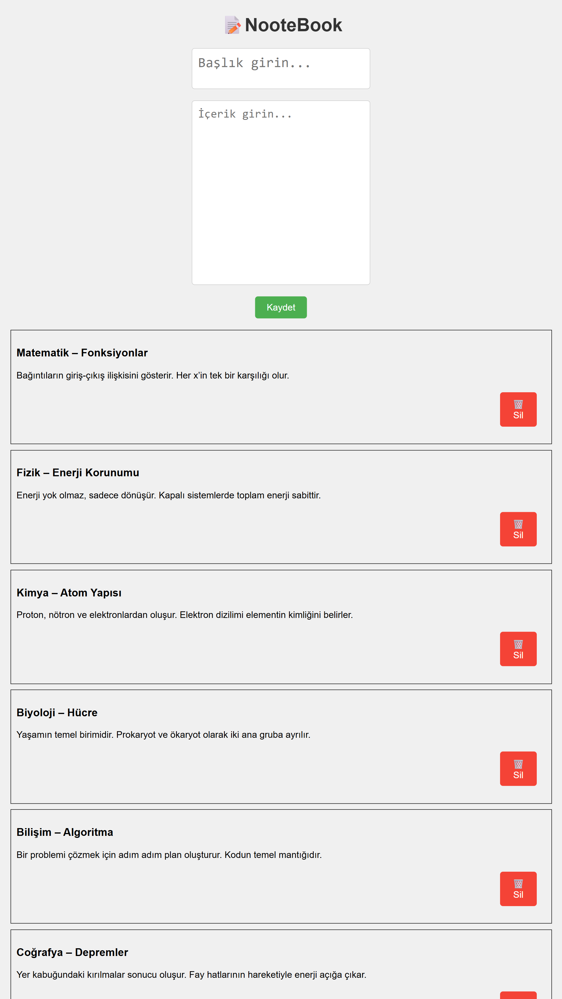

# 📝 NoteBook - Full Stack Not Uygulaması


.NET 8 Web API, SQL Server ve Nginx ile geliştirilmiş, Docker Compose üzerinde tek komutla çalışan bir not defteri uygulaması.



## 🚀 Özellikler

- Not ekleme, listeleme, güncelleme ve silme (REST API)
- HTML/JavaScript ile hazırlanmış sade web arayüzü
- API, veritabanı ve arayüzün ayrı konteynerlerde çalışması
- Veritabanı şifresinin koddan ayrı, `.env` dosyasında tutulması

## 🛠 Kullanılan Teknolojiler

| Katman | Teknoloji |
|--------|-----------|
| Backend | .NET 8 Web API, ADO.NET |
| Frontend | HTML5, JavaScript |
| Veritabanı | MS SQL Server 2022 |
| Altyapı | Docker, Docker Compose, Nginx |

## ⚙️ Kurulum

Gereksinim: [Docker Desktop](https://www.docker.com/products/docker-desktop/)

1. Projeyi indirin:
   ```bash
   git clone https://github.com/evrensercan/NoteBook.git
   cd NoteBook/NoteBook_Backend/NoteBook
   ```

2. `.env.example` dosyasını `.env` adıyla kopyalayın ve içindeki şifreyi değiştirin:
   ```bash
   cp .env.example .env
   ```

3. Uygulamayı başlatın:
   ```bash
   docker compose up -d --build
   ```

4. SQL Server açıldıktan sonra (yaklaşık 20 saniye) not tablosunu oluşturun:
   ```bash
   docker exec sql_server_container bash -c '/opt/mssql-tools18/bin/sqlcmd -S localhost -U sa -P "$MSSQL_SA_PASSWORD" -C -Q "CREATE TABLE [NOT] (Id INT IDENTITY(1,1) PRIMARY KEY, Title NVARCHAR(200), Contents NVARCHAR(MAX))"'
   ```

5. Tarayıcıdan açın:
   - Arayüz: http://localhost
   - API dokümantasyonu (Swagger): http://localhost:5000/swagger
